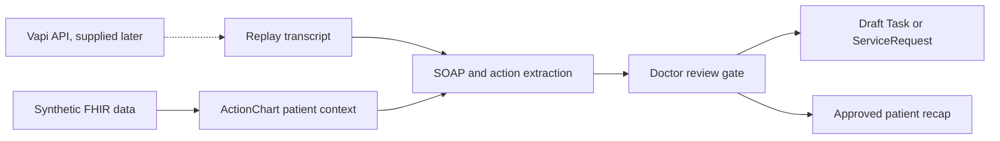

# Codebase analysis

## Overview

The repository is a working Vetra product and research workspace, not a single application. It contains a private research intake app, standalone product previews, Vapi assistant snapshots, outreach material, and a compiled wiki. The new contribution is a human-healthcare hackathon demo called ActionChart Voice. It uses the repository's supervised workflow pattern but does not use Vetra's veterinary branding or clinical claims.

The supplied hackathon data contains 25 synthetic human patients. Each record includes a FHIR Patient, a longitudinal summary, an Encounter with related resources, a transcript, a SOAP note, and an unreviewed after-visit summary. The data is useful for a demo and replay evaluation. It is not a validated benchmark or a complete longitudinal FHIR bundle.

## Architecture

The relevant code and source material form four layers:

The new app is isolated under `apps/actionchart-voice/`. It can run without Vapi through replay and manual review. A future voice adapter will submit the same transcript and patient identifier used by replay mode, so the review flow will not change when voice is connected.

## Tech stack

| Layer | Technology | Version | Notes |
|-------|------------|---------|-------|
| Web application | Next.js | 16.2.6 | App Router through the Sites vinext starter |
| UI runtime | React | 19.2.6 | Client state for review interactions |
| Language | TypeScript | 5.9.3 | Strict application and FHIR draft types |
| Styling | Tailwind CSS and custom CSS | 4.2.1 | Responsive clinician dashboard |
| Deployment build | vinext and Vite | 0.0.50 / 8.0.13 | Cloudflare Worker compatible output |
| Existing Vetra research app | Next.js and React | 16.2.10 / 19.2.7 | Separate private wiki intake surface |
| Voice configuration reference | Vapi, Deepgram Nova-3, ElevenLabs | External | Configuration exists; this contribution defers live API wiring |
| Clinical data | Synthetic FHIR R4-shaped JSON | 25 records | Human healthcare, synthetic only |
| Workflow output | FHIR Task and ServiceRequest drafts | R4 shape | Display and export only; no live EHR write |

## Module breakdown

### ActionChart Voice

- **Purpose:** Returning-patient context, replay intake, SOAP summary, doctor review, FHIR drafts, and patient recap.
- **Key files/directories:** `apps/actionchart-voice/`
- **Dependencies:** Synthetic dataset, React, Next.js, vinext.
- **Status:** Active development. The application shell exists and the product workflow is being implemented.

### Vapi assistant snapshots

- **Purpose:** Preserve existing Vetra assistant prompts, tool behavior, and provider configuration.
- **Key files/directories:** `outputs/vapi-dr-wendy-copy-composer/`
- **Dependencies:** Vapi, Deepgram Nova-3, ElevenLabs, an external webhook.
- **Status:** Reference only for this contribution. The Dr. Wendy assistants are veterinary and must not be edited for the human-healthcare demo.

### Vetra research graph

- **Purpose:** Private document intake and review for the Vetra wiki.
- **Key files/directories:** `apps/vetra-wiki/`, `wiki/`
- **Dependencies:** Vercel Blob, OpenAI, Next.js, local vault sync.
- **Status:** Existing application. It is outside the ActionChart runtime.

### Product and source artifacts

- **Purpose:** Product positioning, voice prompts, research, and demo scope.
- **Key files/directories:** `CLAUDE.md`, `wiki/topics/`, `outputs/hackathon-returning-patient-voice-demo/`
- **Dependencies:** None at runtime.
- **Status:** Current source material with some structural drift in older root documentation.

## Code patterns and conventions

- Existing web applications use TypeScript, React, and the Next.js App Router.
- API code lives in `app/api/**/route.ts`.
- Clinical actions remain proposals until a human accepts or edits them.
- Generated summaries must retain a link to the chart or transcript evidence used to create them.
- Synthetic data and demo limitations must remain visible in the UI.
- Original source files remain unchanged. Application-specific data copies and derived views live inside the new app.

## Testing coverage

The existing research app has typecheck and production build commands. The new Sites starter includes a rendered HTML test, but it does not yet cover the ActionChart workflow.

The first iteration needs checks for:

- Dataset loading across all 25 records.
- SOAP section parsing and action extraction.
- Doctor statuses: approve, edit, reject, and defer.
- Patient recap leakage. Rejected and internal items must never appear.
- FHIR draft shape for Task and ServiceRequest.
- Responsive rendering and a production build.

## Technical debt and known issues

1. **Moderate:** Root documentation describes an older, smaller repository shape and does not list the current apps and source collections.
2. **Moderate:** The existing Vapi snapshots point to an external webhook, but matching webhook code is not present in this repository.
3. **Moderate:** The synthetic dataset includes summary labels that are not complete FHIR Condition or Medication resources.
4. **Moderate:** The repository mixes veterinary product work with a human-healthcare hackathon. The new app needs a clear boundary to avoid cross-domain wording.
5. **Low:** The Vapi assistant snapshots contain duplicated assistant and squad override prompts.
6. **Low:** Several root-level generated files and research exports make broad repository searches noisy.

## Dependencies and integrations

- Vapi is deferred. The future adapter needs patient ID, call ID, transcript events, tool results, and end-of-call status.
- Deepgram Nova-3 and the selected Vapi voice remain outside the current build.
- The app reads a local copy of the supplied synthetic dataset.
- FHIR output is generated locally and stays in draft form.
- No database is required for the single-user hackathon demo. Review state can remain local to the browser.

## Documentation quality assessment

The contribution has strong product scope and data documentation. The existing voice snapshots are detailed enough to reuse conversation patterns, especially one question at a time, short replies, explicit handoffs, and strict medical boundaries.

Five issues were found during cross-reference:

1. Veterinary repository versus human-healthcare dataset. Resolved by isolating ActionChart as a human-healthcare demo.
2. SOAP generation versus Vetra's broader action position. Resolved by treating SOAP as context for the doctor review flow, not the product endpoint.
3. Existing Vapi prompts versus the new domain. Resolved by reusing configuration patterns only.
4. External Vapi webhook versus missing local implementation. Resolved by deferring the adapter until the API is provided.
5. Old root file map versus current repository. Kept as known documentation debt.

## Deployment and infrastructure

The existing Vetra surfaces use Vercel-style deployment. ActionChart uses the Sites vinext scaffold and produces a Cloudflare Worker compatible build. It does not require secrets until the Vapi adapter is connected. The dataset is synthetic and can ship with the demo.

## Recommendations for first iteration

1. Finish the full replay-to-review path before voice integration.
2. Use three curated cases for the live demo while keeping all 25 patients searchable.
3. Make evidence, confidence, patient visibility, and doctor status visible on every proposed action.
4. Generate the recap from approved patient-visible actions only.
5. Keep a narrow Vapi adapter contract so the voice API can be added without changing review logic.
6. Add automated leakage and FHIR-shape checks before deployment.
